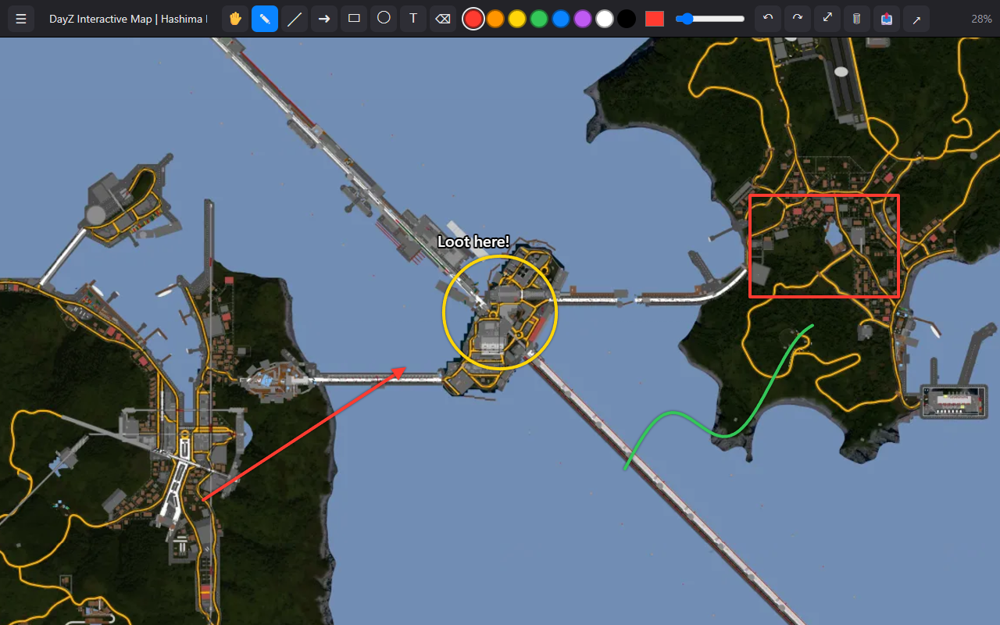
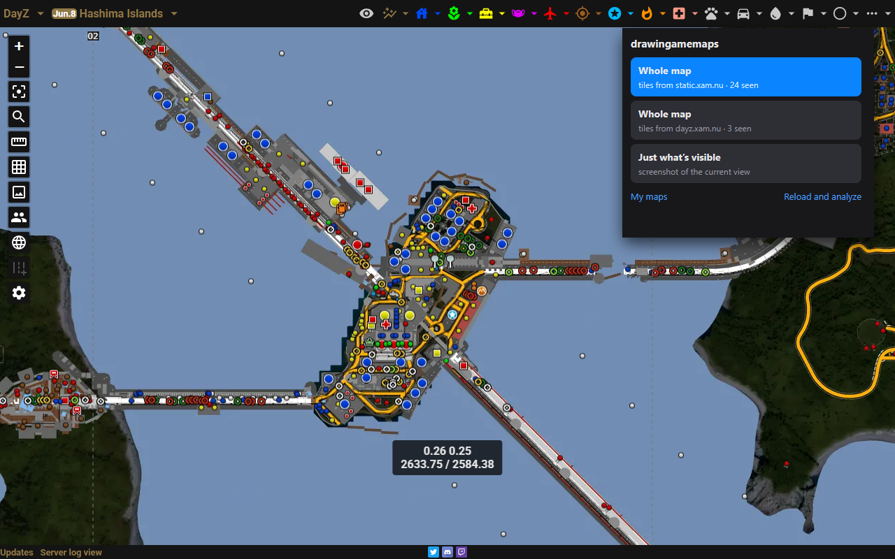
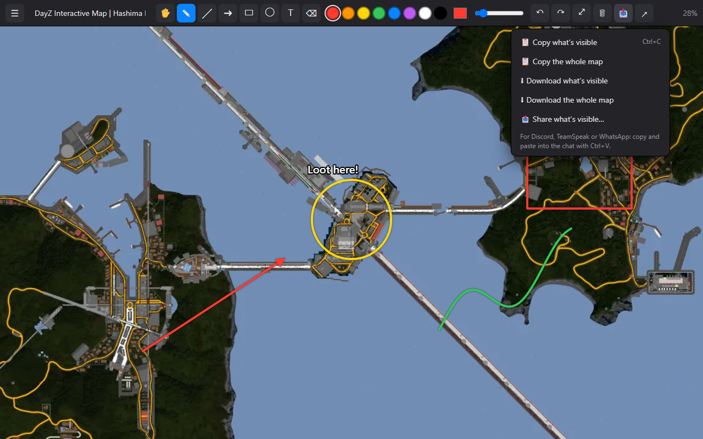

# drawingamemaps

Descarga el **mapa entero** de las webs de mapas de videojuegos y **dibuja encima** con zoom y desplazamiento; los trazos se quedan pegados al terreno. Luego copia, descarga o comparte el resultado (pégalo directamente en Discord, TeamSpeak, WhatsApp…).

  
  

Funciona en navegadores Chromium (Chrome, Brave, Edge, Opera…) y en los basados en Firefox (Firefox, Zen, LibreWolf…). Interfaz en español, inglés, portugués, francés, alemán, italiano, neerlandés, polaco, ruso, ucraniano, chino, japonés, coreano, tailandés e hindi.

Probada en [más de 40 juegos](#webs-probadas), con la lista actualizada el 1 de noviembre de 2026.

*[English version](README.md)*

## Uso

Abre una web de mapa y pulsa **Alt+Shift+M** (o el icono). Elige **Mapa entero** (teselas), **Mapa vectorial (SVG)**, **Imagen completa** o **Solo lo que se ve**; si hace falta, elige el nivel de detalle. Dibuja con lápiz, línea, flecha, rectángulo, círculo, texto y goma. Con el botón 📤 (o **Ctrl+C**) copias lo que se ve y lo pegas en el chat.

## Instalar

- **Firefox, Zen, LibreWolf…**: desde [addons.mozilla.org](https://addons.mozilla.org/firefox/addon/drawingamemaps/).
- **Chrome, Brave, Edge, Opera…**: no está en la Chrome Web Store. Descarga `drawingamemaps-chromium-<versión>.zip` de la [última release](https://github.com/javimentallab/drawingamemaps/releases/latest), descomprímelo, abre `chrome://extensions`, activa el **Modo desarrollador** y pulsa **Cargar descomprimida** sobre la carpeta.

## Webs probadas

La versión 2.2.0 descargó cada uno de estos mapas enteros en un navegador de pruebas (Brave sin ventana), y el resultado se comprobó a ojo en una miniatura. El *tamaño probado* es el nivel que eligió la prueba, no siempre el máximo que ofrece la web.

| Juego | Web | Tamaño probado (px) | Última prueba |
|---|---|---|---|
| AION 2 | [AION2 Hub](https://aion2hub.com/maps) | 8192×8192 | 2026-11-01 |
| Aniimo | [th.gl](https://aniimo.th.gl/maps/Idyll) | 8192×8192 | 2026-11-01 |
| ARC Raiders | [arcraidershub.com](https://arcraidershub.com/maps/dam-battlegrounds) | 4096×4096 | 2026-11-01 |
| Arena Breakout: Infinite | [tcno.co](https://maps.tcno.co/abi/northridge) | 5408×3296 | 2026-11-01 |
| Call of Duty: Modern Warfare 4 | [Map Genie](https://mapgenie.io/call-of-duty-modern-warfare-4/maps/campaign) | 8192×8192 | 2026-10-25 |
| Call of Duty: Warzone | [wzhub.gg](https://wzhub.gg/map/verdansk/br) | 4096×4096 | 2026-11-01 |
| Conan Exiles | [th.gl](https://conanexiles.th.gl/maps/Exiled%20Lands) | 4096×4096 | 2026-11-01 |
| Dark and Darker | [Spells and Guns](https://darkanddarker.map.spellsandguns.com/map/Crypt-01-N) | 2048×2048 | 2026-11-01 |
| DayZ | [xam.nu](https://dayz.xam.nu/hashima) | 8192×8192 | 2026-11-01 |
| DayZ (Nasdara) | [Shackmaps](https://www.shackmaps.com/dayz/nasdara) | 5824×5824 | 2026-10-18 |
| Delta Force | [th.gl](https://deltaforce.th.gl/maps/Zero%20Dam) | 8192×8192 | 2026-11-01 |
| Elden Ring | [Map Genie](https://mapgenie.io/elden-ring/maps/the-lands-between) | 7584×6368 | 2026-11-01 |
| Enshrouded | [th.gl](https://enshrouded.th.gl/maps/Embervale) | 16384×16384 | 2026-11-01 |
| Escape from Tarkov | [tarkov.dev](https://tarkov.dev/map/customs) (SVG) | 8192×4127 | 2026-11-01 |
| Fallout 4 | [fallout4map.com](https://fallout4map.com/) | 5664×4096 | 2026-11-01 |
| Final Fantasy Resonance | [Map Genie](https://mapgenie.io/final-fantasy-resonance/maps/lapis) | 6368×3712 | 2026-10-25 |
| Final Fantasy Resonance | [th.gl](https://finalfantasyresonance.th.gl/maps/World%20Map) | 8192×8192 | 2026-10-25 |
| Genshin Impact | [HoYoLAB](https://act.hoyolab.com/ys/app/interactive-map/index.html) | 5404×4592 | 2026-11-01 |
| Ghost Recon Wildlands | [Map Genie](https://mapgenie.io/ghost-recon-wildlands/maps/bolivia) | 4032×4032 | 2026-11-01 |
| Gray Zone Warfare | [tcno.co](https://maps.tcno.co/gzw) | 4128×2064 | 2026-11-01 |
| GTA V | [gta-5-map.com](https://gta-5-map.com/) | 2816×2816 | 2026-11-01 |
| Humanitz | [Point Atlas](https://point-atlas.io/map/1/Humanitz) | 1941×1913 | 2026-11-01 |
| Loftia | [th.gl](https://loftia.th.gl/maps/Loftia%20City) | 2048×2048 | 2026-10-25 |
| Marathon | [Shackmaps](https://www.shackmaps.com/marathon/perimeter) | 8000×8000 | 2026-11-01 |
| Myth of Empires | [Guild Order](https://guildorder.com/games/myth_of_empires/maps) | 8192×8192 | 2026-11-01 |
| Once Human | [Map Genie](https://mapgenie.io/once-human/maps/nalcott) | 8192×8192 | 2026-11-01 |
| Palworld | [palworld.gg](https://palworld.gg/map) | 8192×8192 | 2026-11-01 |
| Phantom Blade Zero | [Map Genie](https://mapgenie.io/phantom-blade-zero/maps/weeping-creek-valley) | 3072×3072 | 2026-11-01 |
| Project Zomboid (Build 42) | [projectzomboidmap.com](https://projectzomboidmap.com/) | 36162×15923 | 2026-11-01 |
| PUBG | [pubgmap.io](https://pubgmap.io/erangel.html) | 8192×8192 | 2026-11-01 |
| Red Dead Redemption 2 | [Collectors Map](https://jeanropke.github.io/RDR2CollectorsMap/) | 6144×4864 | 2026-11-01 |
| Satisfactory | [satisfactory-calculator.com](https://satisfactory-calculator.com/en/interactive-map) | 4104×4104 | 2026-11-01 |
| SCUM | [scum-map.com](https://scum-map.com/en/interactive_map) | 20480×20480 | 2026-11-01 |
| Sons of the Forest | [th.gl](https://sotf.th.gl/) | 4096×4096 | 2026-11-01 |
| Soulmask | [th.gl](https://soulmask.th.gl/maps/Cloud%20Mist%20Forest) | 4096×4096 | 2026-11-01 |
| Soulmask | [DaOpa](https://gamingwithdaopa.ellatha.com/soulmask/map/) | 1020×1020 | 2026-11-01 |
| The Isle | [XGamingServer](https://xgamingserver.com/tools/the-isle/map) | 8192×8192 | 2026-11-01 |
| The Witcher 3 | [witcher3map.com](https://witcher3map.com/w/) | 5120×4096 | 2026-11-01 |
| Valheim | [th.gl](https://valheim.th.gl/maps/World) | 8192×8192 | 2026-11-01 |
| Vault Breakers | [th.gl](https://vaultbreakers.th.gl/maps/Wolfswood) | 2048×2048 | 2026-10-18 |
| WARDOGS (Bakurani) | [wardogshub.gg](https://wardogshub.gg/map/bakurani/) | 16384×16384 | 2026-11-01 |
| Way of the Hunter 2 | [Shackmaps](https://www.shackmaps.com/way-of-the-hunter-2/hearth-hunt-headquarters-map) | 5504×4096 | 2026-10-25 |
| Zelda: Breath of the Wild | [IGN](https://www.ign.com/maps/the-legend-of-zelda-breath-of-the-wild/hyrule) | 4416×3680 | 2026-11-01 |
| Zelda: Tears of the Kingdom | [Object Map](https://objmap-totk.zeldamods.org/) | 6000×5008 | 2026-11-01 |

**Webs que bloquean el navegador de pruebas.** Funcionaron antes, pero su protección antibots frenó la prueba del 1 de noviembre:

- Comprobadas a mano en Brave el 15 de octubre de 2026: Fortnite ([fortnite.gg](https://fortnite.gg/)) y World of Warcraft ([Wowhead](https://www.wowhead.com/maps)).
- Última prueba automática superada: Skyrim ([UESP](https://en.uesp.net/maps/srmap/srmap.shtml)) el 25 de octubre de 2026 y ARK: Survival Ascended ([wikily.gg](https://wikily.gg/ark-survival-ascended/maps/the-island)) el 18 de octubre de 2026.

**Firefox.** La tabla de arriba se probó en Chromium. En Firefox se probaron DayZ, Genshin Impact, AION 2, Project Zomboid y Dark and Darker el 15 de octubre de 2026.

Los mapas que se dibujan en el navegador a partir de datos (Subnautica, el generador de mundos de Valheim) no tienen imágenes que descargar: ahí solo funciona «Solo lo que se ve».

## Privacidad

No recoge ningún dato; todo se guarda en tu navegador. Ver [PRIVACY.md](PRIVACY.md).

## Licencia

[MIT](LICENSE). Hecha con ayuda de Claude (Anthropic).
