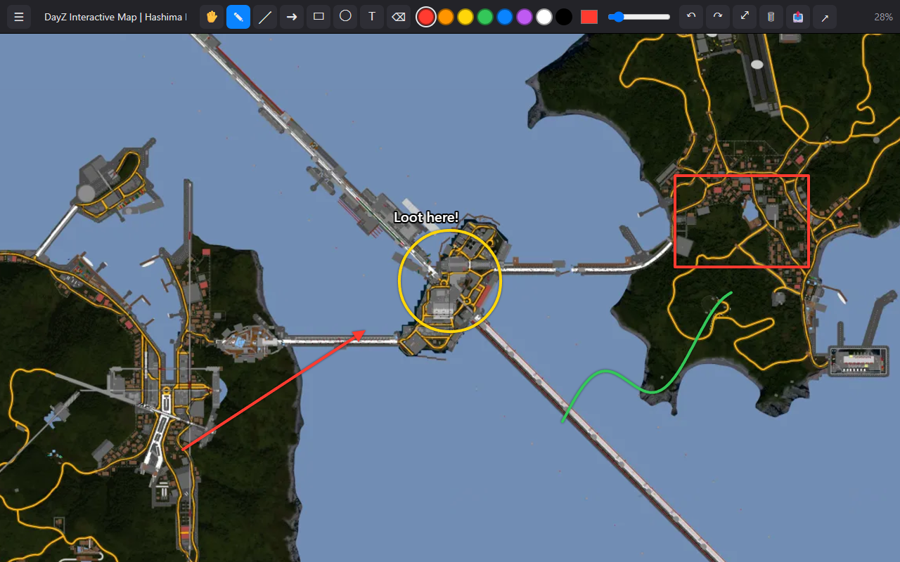
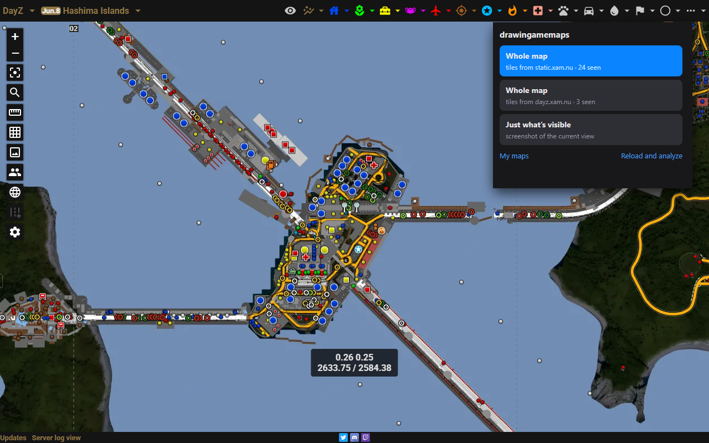
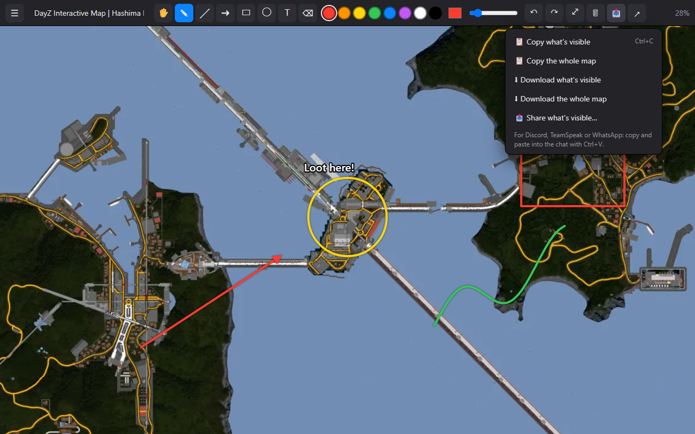

<p align="center"></p>

# drawingamemaps

Download the **whole map** from video game map websites and **draw on it** — with zoom and pan, the strokes stay glued to the terrain. Then copy, download or share the result (paste it straight into Discord, TeamSpeak, WhatsApp…).

<p align="center"></p>
<p align="center">
  
  
</p>

Works in Chromium browsers (Chrome, Brave, Edge, Opera…) and Firefox-based browsers (Firefox, Zen, LibreWolf…). Interface in English, Spanish, Portuguese, French, German, Italian, Dutch, Polish, Russian, Ukrainian, Chinese, Japanese, Korean, Thai and Hindi.

Tested on [more than 40 games](#tested-sites), with the list updated on 1 November 2026.

*[Versión en español](README.es.md)*

## How it works

Open a game map site and press **Alt+Shift+M** (or click the extension icon). drawingamemaps looks at what the page has loaded and offers the best way to get the full map:

| Source | Examples | What it does |
|---|---|---|
| **Tiles** (`z/x/y`, Deep Zoom, flat grids…) | Map Genie, IGN, th.gl, Leaflet / OpenLayers / custom canvas viewers | Works out the URL pattern, the zoom levels and the map extent, and downloads the whole map at the level of detail you choose |
| **Vector map (SVG)** | tarkov.dev | Rasterizes it into tiles at the resolution you pick — zooms without losing sharpness |
| **Single large image** | Dark and Darker, Humanitz | Downloads it as is |
| **Just what's visible** | anything else | A screenshot of the current view |

It also copes with the usual quirks: inverted zoom numbering, `z/y/x` order, flipped rows (TMS), hotlink protection (it sends the map site as `Referer`), filler tiles outside the map, and transparent or plain borders, which it trims.

Then draw: pencil, line, arrow, rectangle, circle, text, eraser, colors and thickness, undo/redo. Everything is saved locally in your browser ("My maps").

## Install

- **Firefox, Zen, LibreWolf…** — from [addons.mozilla.org](https://addons.mozilla.org/firefox/addon/drawingamemaps/).
- **Chrome, Brave, Edge, Opera…** — not on the Chrome Web Store. Download `drawingamemaps-chromium-<version>.zip` from the [latest release](https://github.com/javimentallab/drawingamemaps/releases/latest), unzip it, open `chrome://extensions`, turn on **Developer mode** and click **Load unpacked** on the unzipped folder.
- **From source**: Chromium → *Load unpacked* on `src/`. Firefox → `node tools/build.js`, then `about:debugging#/runtime/this-firefox` → *Load Temporary Add-on* → `dist/firefox/manifest.json`.

## Tested sites

Version 2.2.0 downloaded each of these whole maps in a test browser (Brave without a window), and the result was checked by eye on a thumbnail. *Size tested* is the level the test picked, not always the highest the site offers.

| Game | Site | Size tested (px) | Last test |
|---|---|---|---|
| AION 2 | [AION2 Hub](https://aion2hub.com/maps) | 8192×8192 | 2026-11-01 |
| Aniimo | [th.gl](https://aniimo.th.gl/maps/Idyll) | 8192×8192 | 2026-11-01 |
| ARC Raiders | [arcraidershub.com](https://arcraidershub.com/maps/dam-battlegrounds) | 4096×4096 | 2026-11-01 |
| Arena Breakout: Infinite | [tcno.co](https://maps.tcno.co/abi/northridge) | 5408×3296 | 2026-11-01 |
| Call of Duty: Modern Warfare 4 | [Map Genie](https://mapgenie.io/call-of-duty-modern-warfare-4/maps/campaign) | 8192×8192 | 2026-10-25 |
| Call of Duty: Warzone | [wzhub.gg](https://wzhub.gg/map/verdansk/br) | 4096×4096 | 2026-11-01 |
| Conan Exiles | [th.gl](https://conanexiles.th.gl/maps/Exiled%20Lands) | 4096×4096 | 2026-11-01 |
| Dark and Darker | [Spells and Guns](https://darkanddarker.map.spellsandguns.com/map/Crypt-01-N) | 2048×2048 | 2026-11-01 |
| DayZ | [xam.nu](https://dayz.xam.nu/hashima) | 8192×8192 | 2026-11-01 |
| DayZ (Nasdara) | [Shackmaps](https://www.shackmaps.com/dayz/nasdara) | 5824×5824 | 2026-10-18 |
| Delta Force | [th.gl](https://deltaforce.th.gl/maps/Zero%20Dam) | 8192×8192 | 2026-11-01 |
| Elden Ring | [Map Genie](https://mapgenie.io/elden-ring/maps/the-lands-between) | 7584×6368 | 2026-11-01 |
| Enshrouded | [th.gl](https://enshrouded.th.gl/maps/Embervale) | 16384×16384 | 2026-11-01 |
| Escape from Tarkov | [tarkov.dev](https://tarkov.dev/map/customs) (SVG) | 8192×4127 | 2026-11-01 |
| Fallout 4 | [fallout4map.com](https://fallout4map.com/) | 5664×4096 | 2026-11-01 |
| Final Fantasy Resonance | [Map Genie](https://mapgenie.io/final-fantasy-resonance/maps/lapis) | 6368×3712 | 2026-10-25 |
| Final Fantasy Resonance | [th.gl](https://finalfantasyresonance.th.gl/maps/World%20Map) | 8192×8192 | 2026-10-25 |
| Genshin Impact | [HoYoLAB](https://act.hoyolab.com/ys/app/interactive-map/index.html) | 5404×4592 | 2026-11-01 |
| Ghost Recon Wildlands | [Map Genie](https://mapgenie.io/ghost-recon-wildlands/maps/bolivia) | 4032×4032 | 2026-11-01 |
| Gray Zone Warfare | [tcno.co](https://maps.tcno.co/gzw) | 4128×2064 | 2026-11-01 |
| GTA V | [gta-5-map.com](https://gta-5-map.com/) | 2816×2816 | 2026-11-01 |
| Humanitz | [Point Atlas](https://point-atlas.io/map/1/Humanitz) | 1941×1913 | 2026-11-01 |
| Loftia | [th.gl](https://loftia.th.gl/maps/Loftia%20City) | 2048×2048 | 2026-10-25 |
| Marathon | [Shackmaps](https://www.shackmaps.com/marathon/perimeter) | 8000×8000 | 2026-11-01 |
| Myth of Empires | [Guild Order](https://guildorder.com/games/myth_of_empires/maps) | 8192×8192 | 2026-11-01 |
| Once Human | [Map Genie](https://mapgenie.io/once-human/maps/nalcott) | 8192×8192 | 2026-11-01 |
| Palworld | [palworld.gg](https://palworld.gg/map) | 8192×8192 | 2026-11-01 |
| Phantom Blade Zero | [Map Genie](https://mapgenie.io/phantom-blade-zero/maps/weeping-creek-valley) | 3072×3072 | 2026-11-01 |
| Project Zomboid (Build 42) | [projectzomboidmap.com](https://projectzomboidmap.com/) | 36162×15923 | 2026-11-01 |
| PUBG | [pubgmap.io](https://pubgmap.io/erangel.html) | 8192×8192 | 2026-11-01 |
| Red Dead Redemption 2 | [Collectors Map](https://jeanropke.github.io/RDR2CollectorsMap/) | 6144×4864 | 2026-11-01 |
| Satisfactory | [satisfactory-calculator.com](https://satisfactory-calculator.com/en/interactive-map) | 4104×4104 | 2026-11-01 |
| SCUM | [scum-map.com](https://scum-map.com/en/interactive_map) | 20480×20480 | 2026-11-01 |
| Sons of the Forest | [th.gl](https://sotf.th.gl/) | 4096×4096 | 2026-11-01 |
| Soulmask | [th.gl](https://soulmask.th.gl/maps/Cloud%20Mist%20Forest) | 4096×4096 | 2026-11-01 |
| Soulmask | [DaOpa](https://gamingwithdaopa.ellatha.com/soulmask/map/) | 1020×1020 | 2026-11-01 |
| The Isle | [XGamingServer](https://xgamingserver.com/tools/the-isle/map) | 8192×8192 | 2026-11-01 |
| The Witcher 3 | [witcher3map.com](https://witcher3map.com/w/) | 5120×4096 | 2026-11-01 |
| Valheim | [th.gl](https://valheim.th.gl/maps/World) | 8192×8192 | 2026-11-01 |
| Vault Breakers | [th.gl](https://vaultbreakers.th.gl/maps/Wolfswood) | 2048×2048 | 2026-10-18 |
| WARDOGS (Bakurani) | [wardogshub.gg](https://wardogshub.gg/map/bakurani/) | 16384×16384 | 2026-11-01 |
| Way of the Hunter 2 | [Shackmaps](https://www.shackmaps.com/way-of-the-hunter-2/hearth-hunt-headquarters-map) | 5504×4096 | 2026-10-25 |
| Zelda: Breath of the Wild | [IGN](https://www.ign.com/maps/the-legend-of-zelda-breath-of-the-wild/hyrule) | 4416×3680 | 2026-11-01 |
| Zelda: Tears of the Kingdom | [Object Map](https://objmap-totk.zeldamods.org/) | 6000×5008 | 2026-11-01 |

**Sites that block the test browser.** These worked earlier, but their anti-bot protection stopped the 1 November test:

- Checked by hand in Brave on 15 October 2026: Fortnite ([fortnite.gg](https://fortnite.gg/)) and World of Warcraft ([Wowhead](https://www.wowhead.com/maps)).
- Last passed the automatic test: Skyrim ([UESP](https://en.uesp.net/maps/srmap/srmap.shtml)) on 25 October 2026, and ARK: Survival Ascended ([wikily.gg](https://wikily.gg/ark-survival-ascended/maps/the-island)) on 18 October 2026.

**Firefox.** The table above was tested on Chromium. In Firefox, DayZ, Genshin Impact, AION 2, Project Zomboid and Dark and Darker were tested on 15 October 2026.

Maps that are drawn in the browser from data (Subnautica, Valheim's world generator) have no images to download: only "Just what's visible" works there.

## Development

```
src/                 the extension (Manifest V3, Chromium flavour, no build step, no dependencies)
tools/build.js       builds dist/chromium + dist/firefox and their .zip packages for the stores
tools/i18n-messages.py   English/Spanish texts (+ tools/i18n-more.py, the other 13 languages) → src/_locales
tools/make-icons.py  draws the icon
tools/vigilante/     weekly test robot: runs the extension in a headless browser against many map
                     sites, discovers new games on Map Genie / th.gl / Shackmaps and reports
```

The Firefox build differs only in the manifest (`background.scripts`, `browser_specific_settings`) and a tiny shim that maps `chrome` to `browser`.

## Privacy

drawingamemaps collects no data. Maps and drawings are stored only in your browser; it only connects to the map sites you choose to download from. See [PRIVACY.md](PRIVACY.md).

## License

[MIT](LICENSE). Built with the help of Claude (Anthropic).
